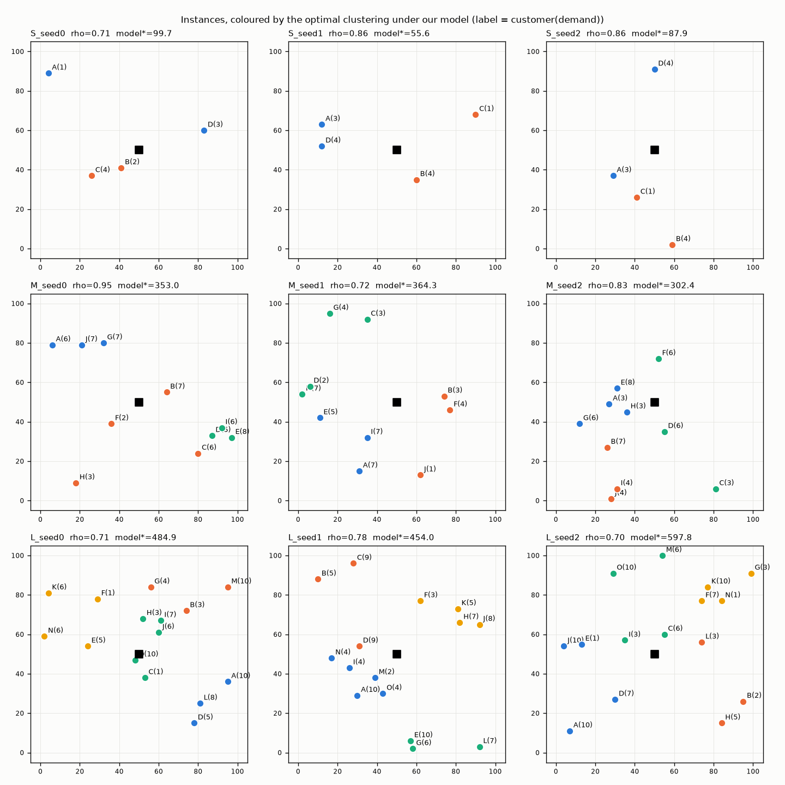

# Instances (A2)

Depot (50, 50). Coordinates: uniform integers in [0,100]². Demands: uniform in the tier range. Accepted only if an exact packing exists and ρ = D/(K·Q) ∈ [0.7, 0.95]. RNG: `numpy.random.default_rng([ord(tier), seed])`.

Reference method: set-partition DP (proven optimum). TSP per group: Held-Karp (exact). Cross-checks: brute force over all assignments (S, M) and CPLEX MILP (all tiers). Vehicle relabelings count as one solution.

Customers are labelled A, B, …; the depot is 0 in tours.

## Tier S: N=4, K=2, Q=7, demands 1..4

| seed | coords (A, B, …) | demands | ρ | d_max/Q | certificate (truck per customer) | optimal clustering (model) | model cost | CVRP optimum (tours) | CVRP length | #opt (model / CVRP) | CPLEX agrees | status |
|---|---|---|---|---|---|---|---|---|---|---|---|---|
| 0 | (4,89) (41,41) (26,37) (83,60) | [1, 2, 4, 3] | 0.714 | 0.57 | [1, 1, 0, 0] | {A,D} / {B,C} | 99.68 | 0→A→C→B→0 / 0→D→0 | 213.99 | 1 / 1 | True | proven optimum |
| 1 | (12,63) (60,35) (90,68) (12,52) | [3, 4, 1, 4] | 0.857 | 0.57 | [0, 0, 1, 1] | {A,D} / {B,C} | 55.60 | 0→A→D→0 / 0→B→C→0 | 195.70 | 1 / 1 | True | proven optimum |
| 2 | (29,37) (59,2) (41,26) (50,91) | [3, 4, 1, 4] | 0.857 | 0.57 | [0, 0, 1, 1] | {A,D} / {B,C} | 87.94 | 0→A→D→0 / 0→B→C→0 | 228.11 | 1 / 1 | True | proven optimum |

## Tier M: N=10, K=3, Q=20, demands 1..8

| seed | coords (A, B, …) | demands | ρ | d_max/Q | certificate (truck per customer) | optimal clustering (model) | model cost | CVRP optimum (tours) | CVRP length | #opt (model / CVRP) | CPLEX agrees | status |
|---|---|---|---|---|---|---|---|---|---|---|---|---|
| 0 | (6,79) (64,55) (80,24) (87,33) (97,32) (36,39) (32,80) (18,9) (92,37) (21,79) | [6, 7, 6, 5, 8, 2, 7, 3, 6, 7] | 0.950 | 0.40 | [1, 0, 2, 0, 0, 2, 1, 2, 2, 1] | {A,G,J} / {B,C,F,H} / {D,E,I} | 353.04 | 0→A→J→G→0 / 0→B→C→H→F→0 / 0→D→E→I→0 | 381.86 | 1 / 1 | True | proven optimum |
| 1 | (31,15) (74,53) (35,92) (6,58) (11,42) (77,46) (16,95) (2,54) (35,32) (62,13) | [7, 3, 3, 2, 5, 4, 4, 7, 7, 1] | 0.717 | 0.35 | [0, 1, 2, 1, 0, 1, 1, 0, 1, 0] | {A,E,I} / {B,F,J} / {C,D,G,H} | 364.25 | 0→I→E→A→J→0 / 0→B→F→0 / 0→C→G→D→H→0 | 368.07 | 1 / 1 | True | proven optimum |
| 2 | (27,49) (26,27) (81,6) (55,35) (31,57) (52,72) (12,39) (36,45) (31,6) (28,1) | [3, 7, 3, 6, 8, 6, 6, 3, 4, 4] | 0.833 | 0.40 | [2, 0, 2, 1, 0, 1, 1, 2, 0, 2] | {A,E,G,H} / {B,I,J} / {C,D,F} | 302.39 | 0→B→G→A→H→0 / 0→D→C→J→I→0 / 0→E→F→0 | 324.32 | 1 / 1 | True | proven optimum |

## Tier L: N=15, K=4, Q=30, demands 1..10

| seed | coords (A, B, …) | demands | ρ | d_max/Q | certificate (truck per customer) | optimal clustering (model) | model cost | CVRP optimum (tours) | CVRP length | #opt (model / CVRP) | CPLEX agrees | status |
|---|---|---|---|---|---|---|---|---|---|---|---|---|
| 0 | (95,36) (74,72) (53,38) (78,15) (24,54) (29,78) (56,84) (52,68) (61,67) (60,61) (4,81) (81,25) (95,84) (2,59) (48,47) | [10, 3, 1, 5, 5, 1, 4, 3, 7, 6, 6, 8, 10, 6, 10] | 0.708 | 0.33 | [0, 1, 2, 2, 2, 2, 2, 2, 1, 1, 1, 1, 0, 2, 0] | {A,D,L} / {B,G,M} / {C,H,I,J,O} / {E,F,K,N} | 484.92 | 0→C→D→L→A→J→0 / 0→H→G→M→B→I→0 / 0→F→K→N→E→O→0 | 397.87 | 1 / 1 | True | proven optimum |
| 1 | (30,29) (10,88) (28,96) (31,54) (57,6) (62,77) (58,2) (82,66) (26,43) (92,65) (81,73) (92,3) (39,38) (17,48) (43,30) | [10, 5, 9, 9, 10, 3, 6, 7, 4, 8, 5, 7, 2, 4, 4] | 0.775 | 0.33 | [0, 2, 0, 1, 0, 3, 1, 1, 2, 1, 2, 2, 3, 2, 2] | {A,I,M,N,O} / {B,C,D} / {E,G,L} / {F,H,J,K} | 454.02 | 0→D→N→I→A→M→0 / 0→B→C→0 / 0→L→G→E→O→0 / 0→F→K→J→H→0 | 472.91 | 1 / 1 | True | proven optimum |
| 2 | (7,11) (95,26) (55,60) (30,27) (13,55) (74,77) (99,91) (84,15) (35,57) (4,54) (77,84) (74,56) (54,100) (84,77) (29,91) | [10, 2, 6, 7, 1, 7, 3, 5, 3, 10, 10, 3, 6, 1, 10] | 0.700 | 0.33 | [0, 2, 1, 1, 2, 1, 2, 2, 2, 0, 0, 2, 2, 2, 1] | {A,D,E,J} / {B,H,L} / {C,I,M,O} / {F,G,K,N} | 597.78 | 0→D→A→J→E→0 / 0→H→B→G→M→O→I→0 / 0→C→F→K→N→L→0 | 503.20 | 1 / 1 | True | proven optimum |

## Decomposition gap (model optimum routed exactly vs CVRP optimum)

| instance | model optimum routed exactly | CVRP optimum | gap |
|---|---|---|---|
| L_seed0 | 452.79 | 397.87 | 13.81% |
| L_seed1 | 480.36 | 472.91 | 1.58% |
| L_seed2 | 533.31 | 503.20 | 5.98% |
| M_seed0 | 381.86 | 381.86 | 0.00% |
| M_seed1 | 377.24 | 368.07 | 2.49% |
| M_seed2 | 348.84 | 324.32 | 7.56% |
| S_seed0 | 234.49 | 213.99 | 9.58% |
| S_seed1 | 195.70 | 195.70 | 0.00% |
| S_seed2 | 228.11 | 228.11 | 0.00% |

Instance files: `instances/<tier>_seed<n>.json` (coords, demands, certificate, references). Regenerate with `python -m cvrp.instances && python -m cvrp.reference`.
