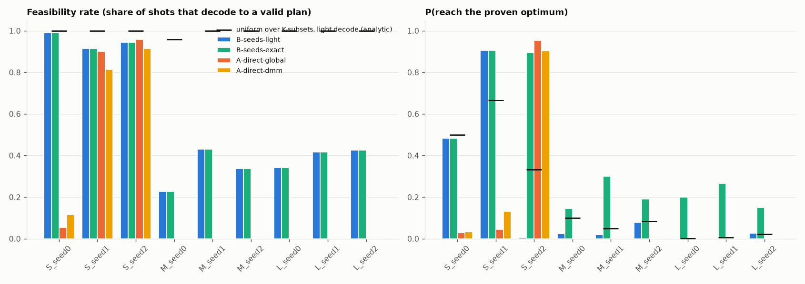
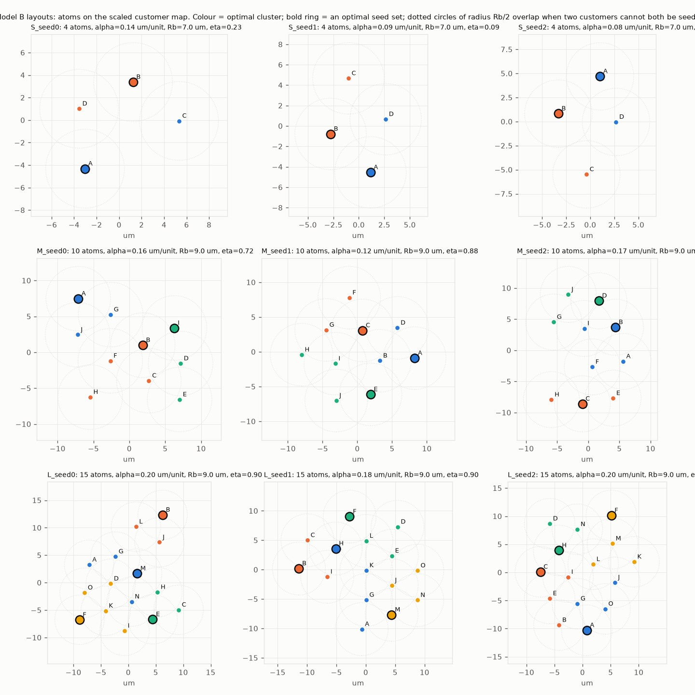

# Results (Track A)

Source: `results/results.csv`. Gaps are on feasible shots only; P(reach) counts shots whose decoded clustering equals the proven optimum (ε = 1e-6, relabelings equal). `feas_random_K` / `p_reach_random_K`: a sampler uniform over exactly-K seed sets with the same decode (analytic). 

| instance | method | atoms | feasibility_rate | feas_random_K | p_reach_ref | p_reach_random_K | p_reach_ratio_vs_random_K | model_best_gap | cvrp_best_gap | eta | gs_rank | emulator | notes |
|---|---|---|---|---|---|---|---|---|---|---|---|---|---|
| S_seed0 | B-seeds-light | 4 | 98.9% | 100.0% | 48.4% | 50.0% | 1.0x | 0.0% | 0.0% | 0.23 | 3 | pulser-simulation | seed-model optimum (light decode) 110.14; 3 of 6 seed sets decode to the optimum |
| S_seed0 | B-seeds-exact | 4 | 98.9% | 100.0% | 48.4% | 66.7% | 0.7x | 0.0% | 0.0% | 0.23 | 3 | pulser-simulation | same shots as light row; exact decode = best feasible assignment to the seeds (classical p |
| S_seed0 | B-random-light | 4 | 39.9% |  | 19.0% |  |  | 0.0% | 0.0% |  |  | uniform random bitstrings | uniform random bitstrings, same decode |
| S_seed1 | B-seeds-light | 4 | 91.5% | 100.0% | 90.5% | 66.7% | 1.4x | 0.0% | 18.8% | 0.09 | 4 | pulser-simulation | seed-model optimum (light decode) 122.26; 4 of 6 seed sets decode to the optimum |
| S_seed1 | B-seeds-exact | 4 | 91.5% | 100.0% | 90.5% | 66.7% | 1.4x | 0.0% | 18.8% | 0.09 | 4 | pulser-simulation | same shots as light row; exact decode = best feasible assignment to the seeds (classical p |
| S_seed1 | B-random-light | 4 | 39.9% |  | 25.1% |  |  | 0.0% | 18.8% |  |  | uniform random bitstrings | uniform random bitstrings, same decode |
| S_seed2 | B-seeds-light | 4 | 94.5% | 100.0% | 0.5% | 33.3% | 0.0x | 0.0% | 0.0% | 0.62 | 5 | pulser-simulation | seed-model optimum (light decode) 155.43; 2 of 6 seed sets decode to the optimum |
| S_seed2 | B-seeds-exact | 4 | 94.5% | 100.0% | 89.3% | 66.7% | 1.3x | 0.0% | 0.0% | 0.62 | 5 | pulser-simulation | same shots as light row; exact decode = best feasible assignment to the seeds (classical p |
| S_seed2 | B-random-light | 4 | 39.9% |  | 12.3% |  |  | 0.0% | 0.0% |  |  | uniform random bitstrings | uniform random bitstrings, same decode |
| M_seed0 | B-seeds-light | 10 | 22.8% | 95.8% | 2.3% | 10.0% | 0.2x | 0.0% | 0.0% | 0.72 | 78 | pulser-simulation | seed-model optimum (light decode) 353.04; 12 of 120 seed sets decode to the optimum |
| M_seed0 | B-seeds-exact | 10 | 22.8% | 100.0% | 14.4% | 30.0% | 0.5x | 0.0% | 0.0% | 0.72 | 37 | pulser-simulation | same shots as light row; exact decode = best feasible assignment to the seeds (classical p |
| M_seed0 | B-random-light | 10 | 10.7% |  | 0.8% |  |  | 0.0% | 0.0% |  |  | uniform random bitstrings | uniform random bitstrings, same decode |
| M_seed1 | B-seeds-light | 10 | 43.1% | 100.0% | 2.0% | 5.0% | 0.4x | 0.0% | 0.0% | 0.88 | 27 | pulser-simulation | seed-model optimum (light decode) 489.32; 6 of 120 seed sets decode to the optimum |
| M_seed1 | B-seeds-exact | 10 | 43.1% | 100.0% | 30.0% | 30.0% | 1.0x | 0.0% | 0.0% | 0.88 | 27 | pulser-simulation | same shots as light row; exact decode = best feasible assignment to the seeds (classical p |
| M_seed1 | B-random-light | 10 | 11.2% |  | 0.3% |  |  | 0.0% | 0.0% |  |  | uniform random bitstrings | uniform random bitstrings, same decode |
| M_seed2 | B-seeds-light | 10 | 33.6% | 100.0% | 8.0% | 8.3% | 1.0x | 0.0% | 2.9% | 0.73 | 69 | pulser-simulation | seed-model optimum (light decode) 329.21; 10 of 120 seed sets decode to the optimum |
| M_seed2 | B-seeds-exact | 10 | 33.6% | 100.0% | 19.0% | 30.0% | 0.6x | 0.0% | 2.9% | 0.73 | 17 | pulser-simulation | same shots as light row; exact decode = best feasible assignment to the seeds (classical p |
| M_seed2 | B-random-light | 10 | 11.2% |  | 1.1% |  |  | 0.0% | 2.9% |  |  | uniform random bitstrings | uniform random bitstrings, same decode |
| L_seed0 | B-seeds-light | 15 | 34.2% | 100.0% | 0.2% | 0.1% | 1.4x | 0.0% | 6.8% | 0.90 | 31 | emu-sv | seed-model optimum (light decode) 475.36; 2 of 1365 seed sets decode to the optimum |
| L_seed0 | B-seeds-exact | 15 | 34.2% | 100.0% | 20.1% | 13.2% | 1.5x | 0.0% | 6.8% | 0.90 | 260 | emu-sv | same shots as light row; exact decode = best feasible assignment to the seeds (classical p |
| L_seed0 | B-random-light | 15 | 2.6% |  | 0.1% |  |  | 0.0% | 6.8% |  |  | uniform random bitstrings | uniform random bitstrings, same decode |
| L_seed1 | B-seeds-light | 15 | 41.6% | 100.0% | 0.0% | 0.7% | 0.0x | 10.2% | 11.3% | 0.90 | 253 | emu-sv | seed-model optimum (light decode) 555.51; 9 of 1365 seed sets decode to the optimum |
| L_seed1 | B-seeds-exact | 15 | 41.6% | 100.0% | 26.7% | 14.1% | 1.9x | 0.0% | 7.7% | 0.90 | 24 | emu-sv | same shots as light row; exact decode = best feasible assignment to the seeds (classical p |
| L_seed1 | B-random-light | 15 | 2.6% |  | 0.0% |  |  | 17.6% | 13.7% |  |  | uniform random bitstrings | uniform random bitstrings, same decode |
| L_seed2 | B-seeds-light | 15 | 42.7% | 100.0% | 2.7% | 2.2% | 1.2x | 0.0% | 3.0% | 0.90 | 279 | emu-sv | seed-model optimum (light decode) 459.22; 30 of 1365 seed sets decode to the optimum |
| L_seed2 | B-seeds-exact | 15 | 42.7% | 100.0% | 15.0% | 14.1% | 1.1x | 0.0% | 3.0% | 0.90 | 259 | emu-sv | same shots as light row; exact decode = best feasible assignment to the seeds (classical p |
| L_seed2 | B-random-light | 15 | 2.6% |  | 0.0% |  |  | 5.5% | 5.4% |  |  | uniform random bitstrings | uniform random bitstrings, same decode |
| S_seed0 | A-direct-global | 4 | 5.4% |  | 2.9% |  |  | 0.0% | 0.0% | 0.54 | 8 | pulser-simulation | penalty loss 0.0% |
| S_seed0 | A-direct-dmm | 4 | 11.5% |  | 3.3% |  |  | 0.0% | 0.0% | 0.54 | 5 | pulser-simulation | penalty loss 0.0% |
| S_seed1 | A-direct-global | 4 | 90.1% |  | 4.4% |  |  | 0.0% | 18.8% | 0.62 | 4 | pulser-simulation | penalty loss 0.0% |
| S_seed1 | A-direct-dmm | 4 | 81.5% |  | 13.2% |  |  | 0.0% | 18.8% | 0.62 | 7 | pulser-simulation | penalty loss 0.0% |
| S_seed2 | A-direct-global | 4 | 95.8% |  | 95.3% |  |  | 0.0% | 0.0% | 0.56 | 2 | pulser-simulation | penalty loss 0.0% |
| S_seed2 | A-direct-dmm | 4 | 91.4% |  | 90.3% |  |  | 0.0% | 0.0% | 0.56 | 1 | pulser-simulation | penalty loss 0.0% |
| S_seed0 | A-random | 4 | 25.1% |  | 12.8% |  |  | 0.0% | 0.0% |  |  | uniform random bitstrings | uniform random bitstrings |
| S_seed0 | A-qubosolver-default | 4 | 0.1% |  | 0.1% |  |  | 0.0% | 0.0% |  |  | qubo-solver[blade+local_energy_scale] | Pasqal qubo-solver default quantum pipeline (its embedder, its drive, DMM device) |
| S_seed1 | A-random | 4 | 51.1% |  | 14.8% |  |  | 0.0% | 18.8% |  |  | uniform random bitstrings | uniform random bitstrings |
| S_seed1 | A-qubosolver-default | 4 | 71.0% |  | 0.7% |  |  | 0.0% | 18.8% |  |  | qubo-solver[blade+local_energy_scale] | Pasqal qubo-solver default quantum pipeline (its embedder, its drive, DMM device) |
| S_seed2 | A-random | 4 | 27.1% |  | 14.8% |  |  | 0.0% | 0.0% |  |  | uniform random bitstrings | uniform random bitstrings |
| S_seed2 | A-qubosolver-default | 4 | 80.4% |  | 80.3% |  |  | 0.0% | 0.0% |  |  | qubo-solver[blade+local_energy_scale] | Pasqal qubo-solver default quantum pipeline (its embedder, its drive, DMM device) |
