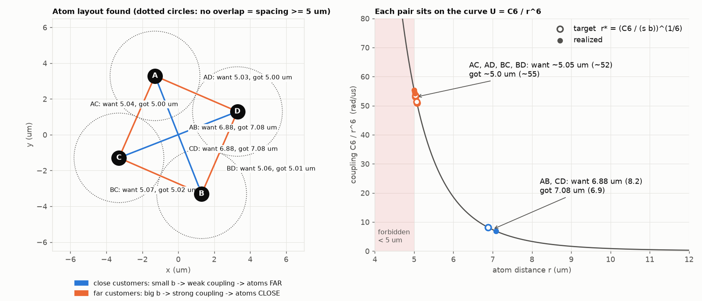

# Track A: Key Equations

**A1:** write one score for every bitstring, where the lowest score = best valid grouping.
**A3:** place atoms so the machine's energy gives the same scores, and report how far off it is.

Example: A, B, C, D, demands [3, 4, 2, 3], 2 trucks, capacity 7. Bit = 1 means truck 1, bit = 0 means truck 2.

## 1. Loss

$$\text{Total Loss} = C_{\text{cluster}} + \lambda\, P_{\text{capacity}}$$

## 2. Cluster

$$C_{\text{cluster}} = \sum_{\text{pairs}} d_{ij}\,(1 - x_i - x_j + 2x_ix_j)$$

| $x_A$ | $x_B$ | same truck? | $1 - x_A - x_B + 2x_Ax_B$ | cost added |
|---|---|---|---|---|
| 0 | 0 | yes | 1 | $d_{AB}$ |
| 0 | 1 | no | 0 | 0 |
| 1 | 0 | no | 0 | 0 |
| 1 | 1 | yes | 1 | $d_{AB}$ |

## 3. Capacity

$$P_{\text{capacity}} = (x_A + x_B + x_C + x_D - 2)^2$$

| bitstring | number of 1s | P | valid? |
|---|---|---|---|
| 1100 | 2 | 0 | ✅ |
| 1110 | 3 | 1 | ❌ |
| 1000 | 1 | 1 | ❌ |
| 1111 / 0000 | 4 / 0 | 4 | ❌ |

## 4. Expanded QUBO

$$\text{Total Loss} = \text{const} + \sum_i a_i x_i + \sum_{i<j} b_{ij} x_ix_j \qquad a_i = -S_i - 3\lambda,\quad b_{ij} = 2d_{ij} + 2\lambda$$

$S_i$ = sum of customer $i$'s distances to everyone else.

**C, one pair: original = expanded**

| $x_A$ | $x_B$ | original $d_{AB}(1 - x_A - x_B + 2x_Ax_B)$ | expanded $d_{AB} - d_{AB}x_A - d_{AB}x_B + 2d_{AB}x_Ax_B$ |
|---|---|---|---|
| 0 | 0 | $d_{AB}$ | $d_{AB}$ |
| 0 | 1 | 0 | $d_{AB} - d_{AB} = 0$ |
| 1 | 0 | 0 | $d_{AB} - d_{AB} = 0$ |
| 1 | 1 | $d_{AB}$ | $d_{AB} - d_{AB} - d_{AB} + 2d_{AB} = d_{AB}$ |

**P: original = expanded**

| number of 1s | original $(n-2)^2$ | expanded $4 - 3n + 2\cdot(\text{pairs of 1s})$ |
|---|---|---|
| 0 | 4 | 4 − 0 + 0 = 4 |
| 1 | 1 | 4 − 3 + 0 = 1 |
| 2 | 0 | 4 − 6 + 2 = 0 |
| 3 | 1 | 4 − 9 + 6 = 1 |
| 4 | 4 | 4 − 12 + 12 = 4 |

## 5. Pasqal energy

$$E = \sum_i (-\delta)\, x_i + \sum_{i<j} \frac{C_6}{r_{ij}^6}\, x_ix_j$$

## 6. Mismatch

| Term | Our QUBO | Pasqal | Match? |
|---|---|---|---|
| per-bit | $a_i$, different for each customer | $-\delta$, the same for all | 🟥 no |
| per-pair value | $b_{ij}$, 6 different values | $C_6/r^6$, set by distance | 🟧 approximately |
| per-pair sign | positive | positive | 🟩 yes |

## 7. Error

$$\text{error} = \text{Pasqal value} - \text{our value (scaled)}$$

Example, bitstring `1100`:

| term | want | got | error |
|---|---|---|---|
| bit A | −57.40 | −56.34 | +1.06 |
| bit B | −55.28 | −56.34 | −1.06 |
| pair AB | 8.16 | 6.86 | −1.30 |
| **total** | | | **−1.30** |

The lowest-energy state is still `1100`, so the error is small enough.

## 8. Atom distance

$$r = \left(\frac{C_6}{\text{wanted coupling}}\right)^{1/6} \qquad r \ge 5\ \mu\text{m},\ \ \text{radius} \le 38\ \mu\text{m}$$

## A4. Pulse parameters

| Parameter | Effect |
|---|---|
| final detuning | fixed by A3 (= the per-bit term) |
| laser strength Ω | lets atoms flip; ends at 0 |
| duration (≤ 6000 ns) | longer = more likely to land on the best answer |
| number of shots | more = more reliable rates |
